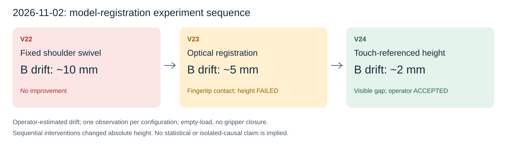
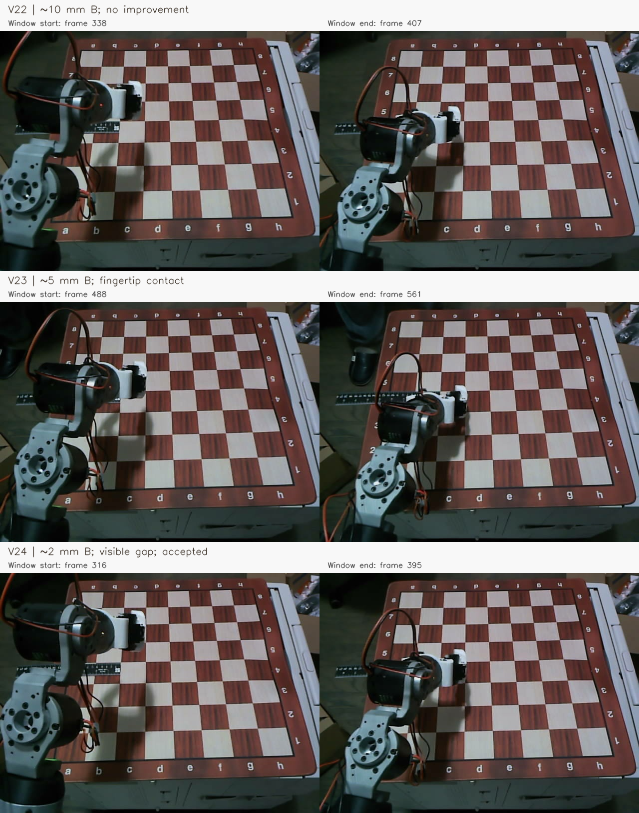

# Figures and captions

## Experiment sequence

Suggested caption: *Sequential model-registration tests on November2, 2026 (America/Los_Angeles). V22 fixed the shoulder swivel reference but retained approximately10mm operator-observed B-direction drift. V23 optical registration reduced reported drift to approximately5mm but failed absolute-height validation through fingertip contact. V24 retained the optical direction registration and used a reported light touch to establish the board-height datum; the operator reported approximately2mm drift, visible clearance, and no oscillation. Each condition has one observation; different registrations change absolute height, so this sequence does not establish statistical significance or isolate causal effects.*

The numbers are operator estimates, not independently instrumented TCP measurements. The confounded original25mm/8mm observation is excluded from the numerical sequence; see the handoff.

## Original camera-frame comparison

Suggested caption: *Original RGB frames at the beginning and end of the recorder's contact/endpoint-settle window for V22–V24. Label bands were added outside the camera image; camera pixels were not geometrically altered. Conditions differ in absolute height and include perspective effects. Reported metric drift comes from the operator, not measurement of this montage.*

Exact source directories/frame indices and image operations are recorded in `raw_frame_comparison_sources.json`. All source RGB frames and aligned depth frames are in the raw evidence archives. Do not use screenshots of this montage as the only retained evidence.

## Viewing videos

`original_review.mp4`, `V22_review.mp4`, `V23_review.mp4`, and `V24_review.mp4` are viewing copies selected by the exact full-run-log association in recorder metadata. They retain the source camera view and append an external band with source frame number, elapsed RGB timestamp, and recorded stage label. They use nominal2fps MP4V playback, not exact timestamp resampling; source timestamps are retained for timing analysis. Compression is lossy, so use archived JPEG/depth for measurement. SHA-256, selected frames, and durations are in `review_video_manifest.json`.

## Data and environment

- `../experiment_trials.csv`: UTF-8 BOM CSV suitable for Excel; blank values mean not separately measured/reported, not zero.
- `../experiment_trials.json`: trial registry, frozen models, source log hashes, and caveats.
- `../environment_record.json`: measured software/device environment.
- `../raw_evidence/archive_manifest.json`: complete member and archive hashes.
- `../reproduce_trial_metrics.py`: model-dependent encoder/FK metrics with explicit frozen per-trial configuration; imports no motor driver.

Prior research material/procedure drafts in `outputs/research_protocol_20261028/` and `outputs/research_protocol_word_20261028/` are background documents. They have not been rewritten to claim these new results or a validated loaded-grasp protocol.
